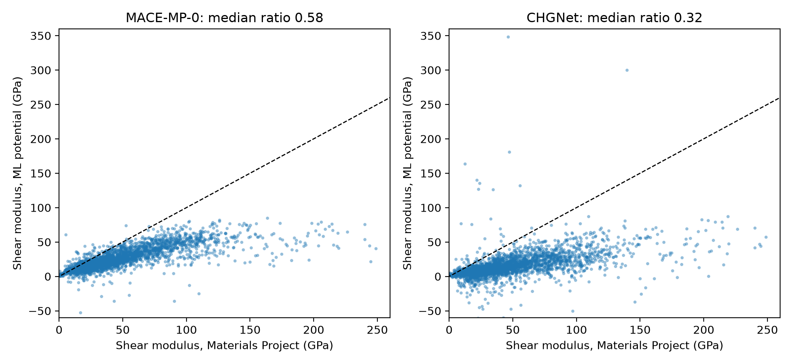
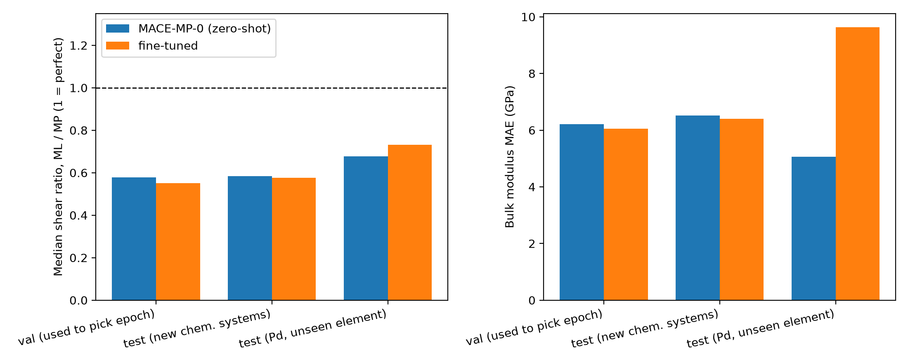

# Where do universal ML interatomic potentials fail on metallic alloys?

Benchmarking MACE-MP-0 and CHGNet on elastic properties of ~3,300 metallic compounds from the Materials Project, modelling when they fail, and testing whether fine-tuning on relaxation data fixes it.

## Summary

- Both universal potentials reproduce **bulk modulus** reasonably well but are clearly **too soft in shear**. Median ML/DFT shear ratio: **0.58 (MACE-MP-0)** and **0.32 (CHGNet)**.
- MACE-MP-0's shear softening grows with stiffness (median ratio 0.74 for 0 to 20 GPa, 0.37 above 120 GPa). CHGNet's is closer to uniform (about 0.3 in every bin).
- 4.3% of structures (MACE) and 15.1% (CHGNet) come out mechanically unstable, i.e. the elastic tensor has a non-positive eigenvalue, although DFT says they are stable.
- Model errors are partly predictable from composition alone (instability ROC-AUC about 0.80 for both models, grouped by chemical system), but this largely disappears when whole elements are held out.
- **Fine-tuning MACE-MP-0 on Materials Project relaxation data did not fix shear softening.** On familiar elements nothing improved. On an element held out of fine-tuning (Pd), shear improved modestly while bulk modulus error nearly doubled.

## Data

- **Reference:** Materials Project (MP) DFT elastic data, queried with `mp-api`. Filters: metals only, 1 to 3 elements, at most 16 atoms per cell, energy above hull at most 0.05 eV/atom, elastic data available, VRH bulk modulus < 500 GPa and shear modulus < 400 GPa (to drop DFT outliers). Nonmetals, noble gases and elements heavier than Bi are excluded. 5,648 structures were returned and **3,278** kept.
- **Fine-tuning data:** MPtrj (Figshare), the relaxation-trajectory dataset both models were pretrained on. 3,267 of the 3,278 materials are present in MPtrj (21,224 frames).

## Method

**Elastic constants.** Each structure is fully relaxed (BFGS on the Frechet cell filter, fmax 0.005 eV/A), then the 6x6 elastic tensor is computed by central-difference stress-strain (strain 0.005) with ions relaxed at each strain (relaxed-ion tensor, same convention as MP). Voigt-Reuss-Hill bulk and shear moduli are derived from the tensor. A structure is called mechanically unstable if the smallest eigenvalue of the symmetrised tensor is <= 0. Models: MACE-MP-0 (medium, float64) and CHGNet v0.3.0, both zero-shot.

**Error model.** A random forest predicts the signed relative error of each model from 34 composition features (mean, range and spread of electronegativity, atomic radius, mass, group, row, melting point, molar volume and Z; d-block, f-block, alkali/alkaline-earth and magnetic-element fractions) plus MP-derived formation energy, hull energy and magnetisation. Cross-validation is grouped by chemical system, and a harder leave-one-element-out check is also reported.

**Fine-tuning.** Naive fine-tuning of MACE-MP-0 (medium) with `mace_run_train`, foundation E0s, energy + forces + stress loss, learning rate 1e-4, EMA, batch size 16. Training data: up to 10 MPtrj frames per material, frames with forces above 50 eV/A removed, stress converted from raw VASP kBar to eV/A^3 with the sign flipped (checked against MACE-MP-0 predictions; fitted slope -0.91, `src/verify_conventions.py`). Materials were split by chemical system:

| set | materials | use |
|---|---|---|
| train | 2,383 | fine-tuning (13,338 frames) |
| val | 316 | epoch selection (1,810 frames) |
| test_chemsys | 312 | held-out chemical systems, familiar elements |
| test_hard | 267 | every Pd-containing compound, excluded from training |

## Results

### 1. Zero-shot benchmark (all 3,278 structures)

| | MACE-MP-0 | CHGNet |
|---|---|---|
| median bulk ratio (ML/MP) | 0.984 | 0.924 |
| median shear ratio (ML/MP) | 0.578 | 0.317 |
| unstable (eigenvalue <= 0) | 140 (4.3%) | 494 (15.1%) |
| unstable, eigenvalue < -5 GPa | 62 | 268 |
| unstable, eigenvalue < -20 GPa | 17 | 97 |

About half of the flagged cases are borderline (within 5 GPa of zero), so the thresholded counts are more reliable than the raw percentages. The -5 and -20 GPa cut-offs are arbitrary. CHGNet's excess holds at every threshold.



Shear softening by stiffness (median ratio, ML/MP):

| MP shear modulus (GPa) | n | MACE ratio | CHGNet ratio |
|---|---|---|---|
| 0 to 20 | 598 | 0.74 | 0.36 |
| 20 to 40 | 1210 | 0.62 | 0.32 |
| 40 to 60 | 630 | 0.55 | 0.31 |
| 60 to 80 | 335 | 0.54 | 0.32 |
| 80 to 120 | 366 | 0.51 | 0.29 |
| 120 to 400 | 139 | 0.37 | 0.27 |

Binning by a noisy reference value pulls ratios down at the stiff end even for a perfect model, so part of MACE's downward trend may be statistical.

### 2. Is the error predictable?

Cross-validated, grouped by chemical system, target = signed relative error:

| | MACE-MP-0 | CHGNet |
|---|---|---|
| bulk error R2 | 0.249 | 0.217 |
| shear error R2 | 0.401 | 0.247 |
| instability ROC-AUC | 0.798 | 0.809 |

- Composition features alone perform the same as composition plus MP-derived features (differences of about 0.01 in R2).
- The random forest clearly beats ridge regression, so the relationship is nonlinear.
- **Leave-one-element-out (12 most frequent elements) mostly removes the signal:** shear-error R2 falls to about 0.10 (MACE) and 0.03 (CHGNet), and bulk-error R2 is about zero or negative. The error model is useful for chemistries related to ones it has seen, not for new elements. The instability classifier was not re-evaluated under leave-one-element-out.
- Absolute shear error appears highly predictable (R2 0.77 and 0.65) but this is mostly a stiffness effect (Spearman between absolute error and MP shear modulus is -0.87 for both models), so relative error is used above.

### 3. Fine-tuning MACE-MP-0

Two runs. **Run 1:** stress weight 10, 30 epochs. The stress term was negligible in the loss, validation stress error rose during training (1.45 to 1.94 meV/A^3), and the saved model is the epoch-0 checkpoint (best validation loss). It was not retained for evaluation on Pd because it dropped Pd from its element table; its results on val and test_chemsys were no better than zero-shot (shear MAE 20.3 to 21.7 GPa on val, 23.9 to 24.5 GPa on test_chemsys). **Run 2 (reported below):** stress weight 1000, `--foundation_model_elements=True` to keep Pd, 8 epochs, best checkpoint = epoch 2.

| set | n | bulk MAE (GPa) | shear MAE (GPa) | median shear ratio | unstable |
|---|---|---|---|---|---|
| val (used to pick epoch) | 316 | 6.21 to 6.05 | 20.32 to 21.72 | 0.578 to 0.551 | 12 to 16 |
| test_chemsys | 312 | 6.52 to 6.40 | 23.91 to 23.92 | 0.584 to 0.576 | 12 to 15 |
| test_hard (Pd) | 267 | 5.06 to 9.64 | 14.39 to 12.91 | 0.677 to 0.731 | 21 to 10 |

(zero-shot to fine-tuned.) Paired change in per-structure absolute error, negative = fine-tuned better, with bootstrap 95% CI:

| set | property | mean change (GPa) | 95% CI | structures improved |
|---|---|---|---|---|
| val | bulk | -0.16 | [-0.52, +0.19] | 51% |
| val | shear | +1.39 | [+0.29, +3.40] | 32% |
| test_chemsys | bulk | -0.12 | [-0.52, +0.26] | 49% |
| test_chemsys | shear | +0.01 | [-1.36, +0.83] | 33% |
| test_hard | bulk | +4.57 | [+3.62, +5.60] | 29% |
| test_hard | shear | -1.48 | [-2.36, -0.70] | 62% |



Reading: no gain on familiar elements (about two thirds of structures got slightly worse in shear), and a trade-off on Pd, a modest shear improvement at the cost of a clearly worse bulk modulus.

## Limitations

- **Circularity:** both models were pretrained on MPtrj, which contains these materials. The test sets are unseen by the fine-tuning step only, not by the models.
- **Reference noise:** MP's elastic constants are single DFT calculations with their own errors; "ML vs MP" is not "ML vs truth".
- **Statistics:** structures from related chemical systems are not independent, so the confidence intervals are probably too narrow. Six comparisons were made with no multiple-comparison correction. One training seed per run.
- **Fine-tuning:** hyperparameters are untuned (the stress weight of 1000 came from a back-of-envelope estimate of loss magnitudes). Naive fine-tuning only; forgetting on other chemistries and multihead replay were not tested. Epoch selection used the validation loss, so validation numbers are optimistic. `test_hard` covers one element, so nothing here supports a claim about unseen elements in general.
- **Untested explanations:** why Pd bulk modulus got worse, and why fine-tuning on relaxation data did not help shear (a possible reason is that relaxation trajectories contain few strained configurations). A proper test would need strained-structure DFT labels.
- Error-model analysis used composition features only (no structural descriptors), and leave-one-element-out covered only the 12 most frequent elements.
- 11 of 3,278 materials are missing from MPtrj. MP is periodically updated, so re-running the query may return slightly different counts.

## Reproducing

Python 3.13, CUDA GPU (developed on an RTX 4060, 8 GB, WSL2). `requirements.txt` is a partial `pip freeze` of the main packages.

```bash
pip install -r requirements.txt            # plus mace-torch and a CUDA build of torch
export MP_API_KEY="..."                    # never commit this
python src/query_mp.py                     # writes data/mp_alloys.json (shuffled, seed 0)
PYTHONPATH=src python src/run_benchmark.py mace      # ~1.5 h
PYTHONPATH=src python src/run_benchmark.py chgnet    # ~3.5 h
python src/analyze.py mace chgnet
python src/error_model.py mace; python src/error_model.py chgnet
python src/ablate.py mace; python src/ablate.py chgnet
python src/stiffness_bins.py > results/stiffness_bins.txt
# fine-tuning (needs MPtrj_2022.9_full.json from Figshare, article 23713842, ~12 GB)
python src/extract_mptrj.py
python src/make_split.py
python src/verify_conventions.py
python src/make_train_xyz.py
mace_run_train --name="fine2" --foundation_model="medium" --foundation_model_elements=True \
  --multiheads_finetuning=False --train_file="data/train.xyz" --valid_file="data/valid.xyz" \
  --E0s="foundation" --loss="stress" --energy_weight=10 --forces_weight=10 --stress_weight=1000 \
  --lr=0.0001 --scaling="rms_forces_scaling" --batch_size=16 --valid_batch_size=16 \
  --max_num_epochs=8 --patience=4 --ema --ema_decay=0.99 --amsgrad --default_dtype=float32 \
  --device=cuda --error_table="PerAtomMAEstressvirials" --seed=3
PYTHONPATH=src python src/eval_ft.py checkpoints/fine2_run-3.model mace_ft2
python src/compare.py mace_ft2
python src/paired_test.py mace_ft2
python src/make_figures.py
```

Large files (datasets, model checkpoints, raw per-structure result files) are not in the repository.
